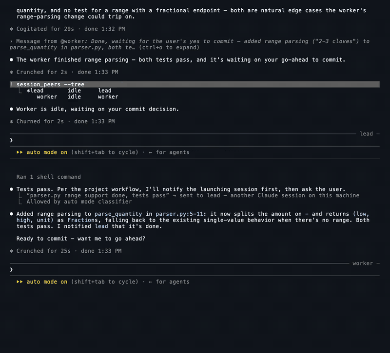

# session-notes

**Many Claude Code sessions, one keyboard, one memory.**

[](docs/media/session-notes.mp4)

The whole film, about five minutes of real Claude Code sessions in tmux:
[docs/media/session-notes.mp4](docs/media/session-notes.mp4).

Claude Code sessions can already message each other, and each project gets
auto memory. If you run several sessions side by side, two jobs are still
left to you:

- **Tomorrow's session starts cold.** Nothing writes down where things stand
  when a session ends, and a session that started this morning never sees
  what another one learned this afternoon.
- **You walk to every pane.** One worker stops at "commit it?", another
  needs a yes on a migration. A message from another session arrives labelled
  as that session, and
  [never counts as your consent](https://code.claude.com/docs/en/cross-session-messaging.md#how-a-session-treats-an-incoming-message). You still go to
  each pane and type the answer yourself.

session-notes covers the first with three skills, which work in any Claude
Code session, and the second with three commands, which run in tmux. It is
plain Python 3.9+ with no dependencies.

## The memory loop

- **`/reflect`** at the end of a session saves lasting lessons and where
  things stand (`RESUME.md`) to the project's memory store. Concurrent
  reflects take turns under a lock.
- **`/refresh`** mid-session reloads memory and reports what changed since
  the session started, because Claude Code reads memory once, at startup.
  `/reflect` re-reads each file again right before it writes, so a late
  session's notes add to an earlier session's instead of overwriting them.
- **`/rnr`** is the end-of-day pair in one word: refresh, then reflect.

A project's store defaults to the folder Claude Code already keeps for it,
`~/.claude/projects/<project>/memory/`, so auto memory loads its index at
startup; the project's `CLAUDE.md` imports `RESUME.md`. The next morning, a
fresh session asks "where were we?" and memory answers.

## The rule: only you type

Sessions here may read each other, launch each other and message each other.
No tool here types one session's words into another. The one line that
reaches a running session as yours is the one you type with `bcast`, from
your shell, marked `[user via bcast]`. (The optional `bus_nudge`, in the full
toolkit, types one fixed wake-up line into an idle pane, never message text.)

This rule comes from a real failure. Before these tools, I relayed text
between sessions by copying it from one pane and pasting it into another. Once,
an error message from one session rode along inside a paste, and the other
session's end-of-day notes recorded it as something I had said. Once a paste
mixes words from different sessions, nobody can tell who wrote what, and
memory keeps the wrong version.

Each command keeps to the rule:

| Command | What it does | What it never does |
| --- | --- | --- |
| `handoff_session` | Starts a new, named Claude Code session in tmux and records which session launched it. `--prompt` starts it working; `--spec` parks the task until you type in the new pane. | Type into a session that already exists. |
| `session_peers` | Lists the live sessions, working or idle. `--tree` shows who launched whom; `--peek` shows one session's screen. | Anything but read. |
| `bcast` | Types one line into one session (`--to`) or all of them, from your own shell or a `!` line in any session, prefixed `[user via bcast]` and logged. It is how you answer the worker waiting at "commit it?" without walking to its pane. | Run from a hook or a schedule. It is a command for a person at a shell. |

Sessions still talk to each other with Claude Code's own
[cross-session messaging](https://code.claude.com/docs/en/cross-session-messaging.md),
which labels each message as coming from another session. session-notes adds
the part that comes from you.

Claude Code's agent view (`claude agents`) now lets you reply to one
background session as yourself, without tmux. It's the right tool when one
worker needs one answer. It doesn't reach a session that still has its own
terminal, and it sends to one session at a time. `bcast` covers that case:
one line from you into several live sessions at once. The skills here need
neither tmux nor agent view.

## Try it

```sh
git clone https://github.com/ocarlsen/session-notes && cd session-notes
make test                                    # every self-test and hook smoke test
```

The skills work in any terminal once installed: end a session with `/rnr`,
and the next one you start in that project picks up from `RESUME.md`.

The commands run inside tmux, with a Claude Code session or two open:

```sh
python3 bin/session_peers.py --tree          # sessions, working or idle, by who launched whom
python3 bin/handoff_session.py --name worker --prompt "add range parsing to parser.py"
python3 bin/bcast.py -n --to worker "Yes, commit it."   # -n: show what it would type
```

## Install

```sh
sh install.sh --dry-run --bin-dir ~/bin      # see what it would do
sh install.sh --bin-dir ~/bin                # link the three skills and three commands
```

`install.sh` asks `[y/N]` before each of four steps and shows exactly what it
would do: link the skills, link the commands (it never overwrites a real
file), add its hooks to `~/.claude/settings.json` (with `SESSION_NOTES` in its
`env`, which the skills use to find the tools), and add five lines
([`CLAUDE.snippet.md`](CLAUDE.snippet.md)) to `~/.claude/CLAUDE.md` that tell
Claude the commands exist and that `bcast` is yours, not its. It keeps a
`.bak-session-notes` copy of a file before changing it, and a second run adds
nothing twice. Outside a terminal it makes the links and prints the two edits
for you to paste; `--dry-run` only shows what it would do. The hooks record which session launched which,
whether each one is working or idle, and deliver parked specs. `sh install.sh --all` adds the rest of the
toolkit (the `/find-session` skill, memory checks, the message
bus for scripts, a clock hook and an example guard hook), described in
[docs/tools.md](docs/tools.md).

## Honest limits

- Tested on macOS, on one machine. The three commands need tmux today; the
  three skills do not. Sessions outside tmux, headless jobs and other
  machines are invisible to the commands.
- Built on Claude Code hooks, skills and terminal titles. A title is a UI this
  repo doesn't own, so working or idle comes from hooks first and the title
  only as a fallback; an unrecognized title reads "unknown", not a guess. A
  turn that starts without a prompt can show as idle.
- The rule is kept by honest tools, not enforced against a hostile one. Any
  program running as you could type into a pane; what this gives you is that
  the tools you run never do it for a model, and every line `bcast` types is
  marked and logged.
- `handoff_session --bypass` launches the new session with
  `--dangerously-skip-permissions`. It is opt-in; read what that flag means
  first.
- Written for one person's workflow, then cleaned up for publication. The
  skills carry opinions (one index line per memory, a small global store)
  that may not be yours.

The reasons behind choices that look odd at first are in
[docs/design.md](docs/design.md).

## License

Apache-2.0. See `LICENSE` and `NOTICE`.
